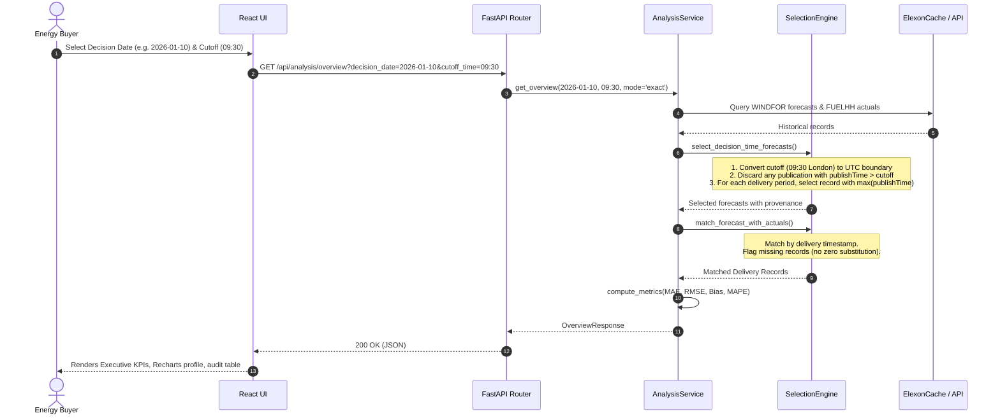

# WindScope — System Architecture & Data Engineering

## 1. High-Level Architecture Overview

WindScope is architected as a decoupled, production-grade intelligence platform consisting of:
1. **React TypeScript Frontend**: High-performance enterprise analytics interface utilizing Recharts, Tailwind CSS, and strict typing.
2. **FastAPI Python Backend**: Statistically rigorous calculation and selection engine with timezone-aware normalization.
3. **Resilient Data Layer**: HTTP client interacting with the official Elexon BMRS API with exponential retries and an indexed SQLite persistent cache.

```mermaid
flowchart TD
    subgraph Upstream["Upstream Market Operator (Elexon BMRS)"]
        E_FUELHH["FUELHH/stream (Actuals)"]
        E_WINDFOR["WINDFOR/stream (Forecasts)"]
    end

    subgraph DataLayer["Backend Ingestion & Cache Layer"]
        HTTPClient["ElexonClient (httpx, retries, timeout)"]
        SQLiteCache[("SQLite Cache (data/cache/bmrs_cache.db)")]
        HTTPClient -->|Cache Miss| E_FUELHH
        HTTPClient -->|Cache Miss| E_WINDFOR
        HTTPClient <-->|Fast Lookup| SQLiteCache
    end

    subgraph AnalyticsEngine["FastAPI Analytics Engine"]
        TimeUtils["DateTimeUtils (Europe/London & UTC)"]
        SelectionService["ForecastSelection (Cutoff Enforcement)"]
        MetricsService["AccuracyMetrics (MAE, RMSE, Bias, MAPE)"]
        AnalysisService["AnalysisService (Orchestrator)"]

        TimeUtils --> SelectionService
        DataLayer --> SelectionService
        SelectionService --> MetricsService
        MetricsService --> AnalysisService
    end

    subgraph APIRoutes["FastAPI REST API"]
        GET_Overview["GET /api/analysis/overview"]
        GET_Forecast["GET /api/analysis/forecast"]
        GET_Records["GET /api/analysis/records"]
        GET_Accuracy["GET /api/analysis/accuracy"]
        GET_Export["GET /api/analysis/export (CSV)"]
        GET_Health["GET /api/health"]
    end

    AnalysisService --> APIRoutes

    subgraph Frontend["React TypeScript Enterprise UI"]
        UI_Shell["App Shell & Navigation"]
        UI_Controls["Decision Controls (Date, Cutoff, Mode)"]
        UI_Overview["Executive Overview Cards"]
        UI_Chart["Forecast vs Actual Time Series (Recharts)"]
        UI_Trends["January Accuracy Trends (MAE/Bias)"]
        UI_Table["Audit Records Table & CSV Download"]
        UI_Methodology["Methodology & Disclaimer Panel"]

        APIRoutes <-->|JSON & CSV| Frontend
    end
```

---

## 2. Decision-Time Forecast Selection Pipeline

To evaluate day-ahead purchasing decisions without lookahead bias, the retrospective forecast selection algorithm reconstructs the exact information state visible to a market trader at decision cutoff time.



---

## 3. Core Modules & Responsibilities

| File Path | Primary Responsibility |
| :--- | :--- |
| `backend/app/main.py` | FastAPI application initialization, CORS security, exception handling, and routing. |
| `backend/app/config.py` | Pydantic BaseSettings, environment variables, default market cutoffs, timeouts. |
| `backend/app/utils/datetime_utils.py` | Timezone-aware date parsing (`Europe/London`, `UTC`), British Summer Time transition rules, settlement period calculation (1-48, 46, 50). |
| `backend/app/services/forecast_selection.py` | Core selection algorithm: inclusive cutoff filtering (`publishTime <= cutoff`), latest eligible version selection, resolution mapping, matching with FUELHH. |
| `backend/app/services/accuracy_metrics.py` | Mathematical calculations for MAE, RMSE, Forecast Bias ($F - A$), and MAPE (with strict zero-actual exclusion tracking). |
| `backend/app/services/elexon_client.py` | Resilient HTTP client with bounded retries, exponential backoff, rate-limit (429) backoff, and timeouts. |
| `backend/app/services/cache_service.py` | SQLite indexed storage (`data/cache/bmrs_cache.db`) for fast, offline, reproducible lookups. |
| `backend/app/services/analysis_service.py` | Multi-day aggregation, trend compilation, and streaming CSV generation. |
| `frontend/src/App.tsx` | Main state orchestration, reactive date switching, and tab management. |
| `frontend/src/components/ExecutiveOverview.tsx` | Executive summary cards (Avg/Peak generation, MAE, Bias, Coverage, Latest publication). |
| `frontend/src/components/ForecastActualChart.tsx` | High-contrast Recharts time-series with clean gap handling (`connectNulls={false}`). |
| `frontend/src/components/DailyAccuracyChart.tsx` | 31-day January 2026 interactive trend of MAE and Bias. |
| `frontend/src/components/RecordsTable.tsx` | Sortable, searchable table of delivery periods with quality flag badges and CSV download. |
| `frontend/src/components/MethodologyPanel.tsx` | Interactive modal explaining data sources, time semantics, formulas, and market caveats. |
